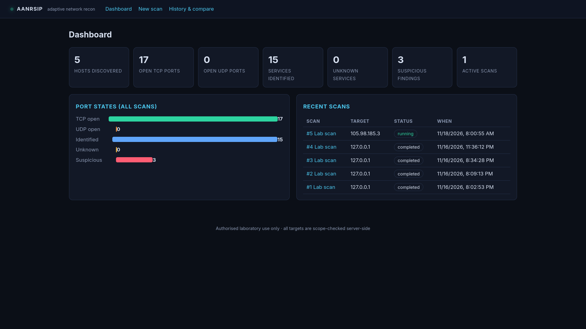
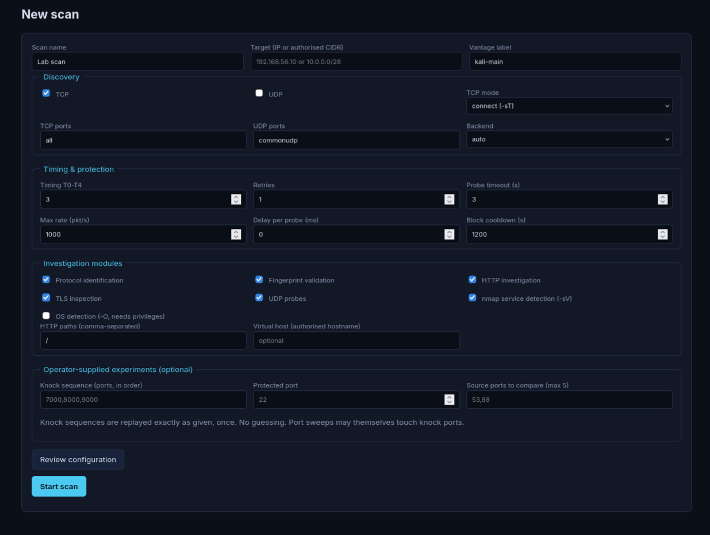
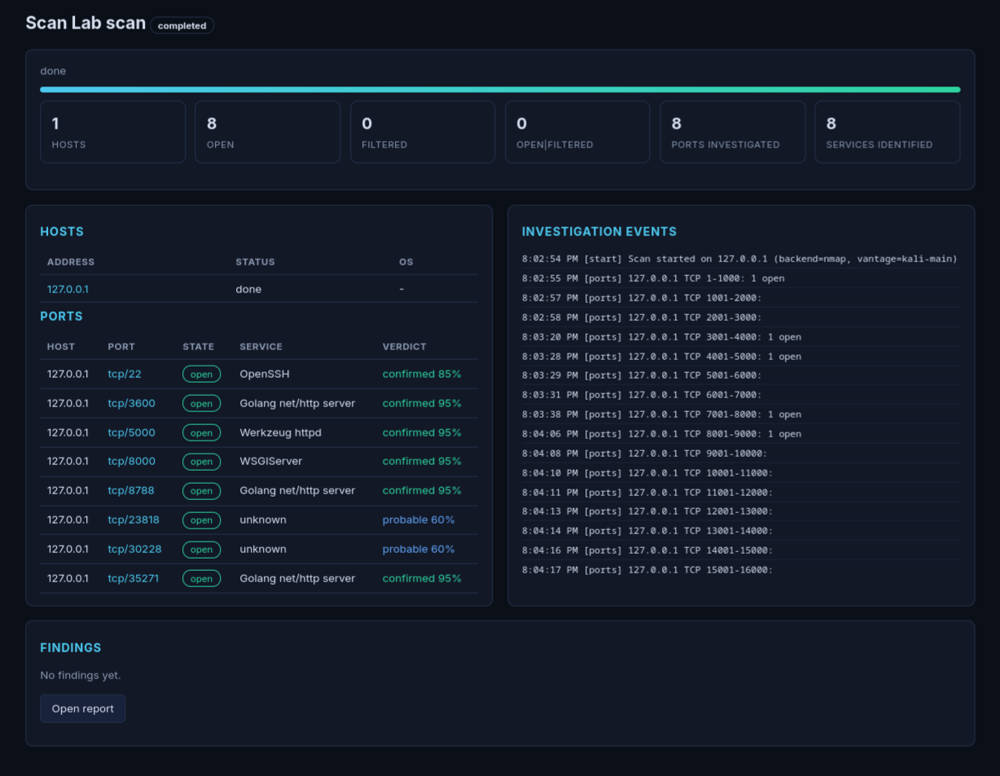
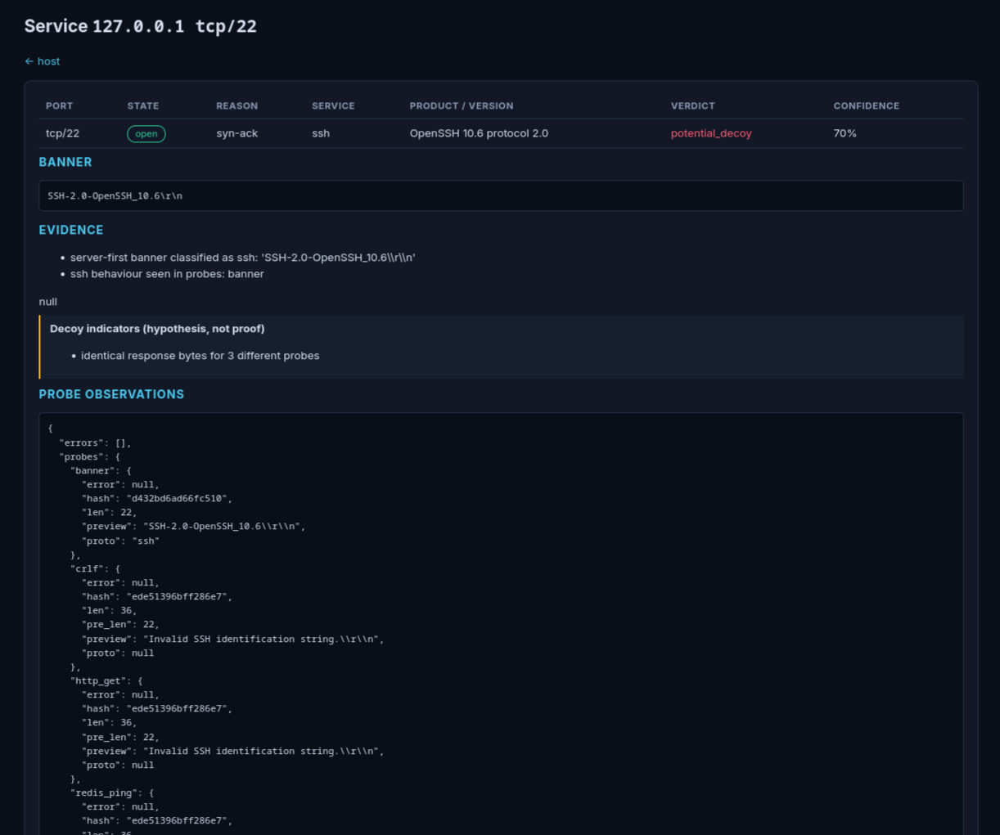
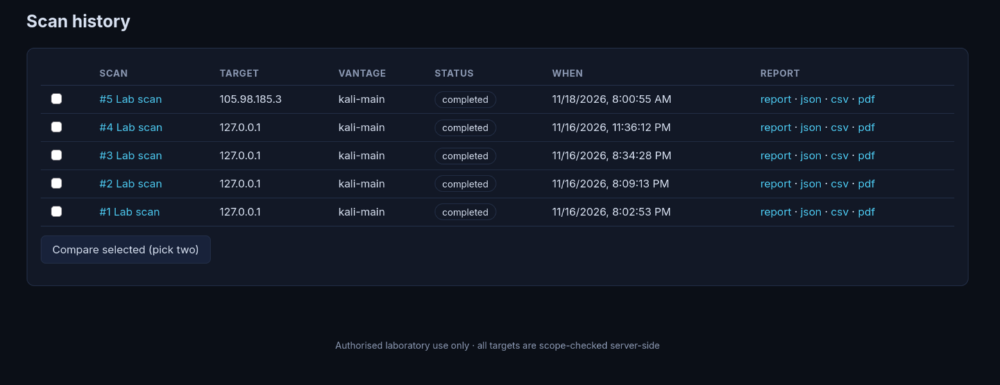

# AANRSIP

**Adaptive Network Reconnaissance & Service Investigation Platform**

AANRSIP is a Flask and Python application for discovering hosts and investigating network services on **explicitly authorised laboratory networks**. It combines nmap or a built-in Python scanner with protocol probes, service-behaviour validation, adaptive protection, SQLite checkpoints, and HTML/JSON/CSV/PDF reporting.

> **Authorisation required:** Only scan systems and networks you own or are explicitly permitted to assess. The application rejects hostnames, public targets, and ranges outside its configured allowlist.

## Screenshots

### Dashboard



### Create a scan



### Live scanning



### Port checking



### Scan history




## Features

- Web-based dashboard, live scan progress, history, and comparison views
- TCP and UDP discovery
- nmap backend with a pure-Python socket fallback
- Fixed, whitelisted nmap arguments and server-side scope validation
- Banner, HTTP, TLS, DNS, and protocol-specific probes
- Service verdicts based on observed behaviour rather than banners alone
- Checkpoints, cancellation, pause/resume, and adaptive backoff
- Knock-sequence and operator-supplied source-port experiments
- SQLite persistence
- JSON, CSV, HTML, and PDF reports
- CSRF protection, token authentication, security headers, and formula-injection-safe CSV exports

## Project layout

```text
.
├── app/                     Flask application
│   ├── routes/              API, authentication, and HTML routes
│   ├── static/              Browser JavaScript and CSS
│   └── templates/           Jinja templates
├── scanner/                 Independent scan engine
│   ├── adaptive/            Blocking and rate-limit assessment
│   ├── discovery/           nmap and built-in discovery backends
│   ├── fingerprinting/      Claim-versus-behaviour validation
│   ├── investigation/       Protocol investigation modules
│   ├── protocols/           Network probes
│   └── reporting/           Report generation and comparison
├── docs/
│   └── screenshots/         Project documentation images
├── scripts/run_mock_lab.py  Local mock laboratory
├── tests/                   Unit and integration tests
├── config.example.py        Environment variable reference
├── requirements.txt         Python dependencies
└── run.py                   Application entry point
```

## Requirements

- Python 3.10 or newer
- nmap (optional for the nmap backend; the built-in scanner remains available)
- A virtual environment
- An explicitly authorised lab or local test network

## Quick start on Arch Linux

The following commands run the application as an unprivileged user.

inside Web-scanner folder

```fish

sudo pacman -S --needed python python-pip python-virtualenv nmap
python -m venv .venv
source .venv/bin/activate.fish

python -m pip install --upgrade pip
python -m pip install -r requirements.txt
python -m pytest tests -q

export SCANNER_ALLOWED="192.168.56.0/24,192.168.0.0/24"
export SCANNER_NMAP_PRIVILEGED=1
python run.py
```

Open <http://127.0.0.1:5000>.

Do not use `sudo pip` or `sudo python run.py`; PEP 668 protects the system Python on Arch Linux, and the application should not run as root.

### Arch: optional privileged nmap operations

SYN scans, UDP raw-socket operations, and OS detection require nmap privileges. Prefer granting capabilities to the nmap executable instead of running the whole application with elevated privileges:

```fish
sudo pacman -S --needed libcap
nmap_path=(readlink -f (which nmap))
sudo setcap cap_net_raw,cap_net_admin,cap_net_bind_service+eip $nmap_path
export SCANNER_NMAP_PRIVILEGED=1
python run.py
```

Then enable SYN mode or OS detection from a scan. To remove the capabilities:

```fish
sudo setcap -r (readlink -f (which nmap))
```

Without privilege capabilities, leave `SCANNER_NMAP_PRIVILEGED` unset and use TCP connect scans.

## Kali Linux setup

Kali Linux may provide nmap and Python in one terminal setup:

```bash
cd /path/to/Web-scanner
sudo apt update
sudo apt install -y python3 python3-venv python3-pip nmap

python3 -m venv .venv
source .venv/bin/activate
python -m pip install --upgrade pip
python -m pip install -r requirements.txt
python -m pytest tests -q

export SCANNER_ALLOWED="192.168.56.0/24,192.168.0.0/24"
python run.py
```

Open <http://127.0.0.1:5000>.

For TCP connect discovery, no sudo or nmap capabilities are required. When privileged scan modes are needed on Kali, use nmap capabilities or Kali's approved privilege setup, keep the Flask process unprivileged, and set:

```bash
export SCANNER_NMAP_PRIVILEGED=1
python run.py
```

## Configuration

Environment variables are read when the application starts.

| Variable | Purpose | Default |
|---|---|---|
| `SCANNER_ALLOWED` | Comma-separated authorised IPv4 or IPv6 CIDRs | Private lab networks |
| `SCANNER_BIND` | Server bind address | `127.0.0.1` |
| `SCANNER_PORT` | Server port | `5000` |
| `SCANNER_TOKEN` | Browser/API authentication token | Empty |
| `SCANNER_SECRET_KEY` | Flask session secret | Persisted/generated key |
| `SCANNER_DB` | SQLite database path | `database/scanner.db` |
| `SCANNER_NMAP` | Custom nmap executable path | Executable from `PATH` |
| `SCANNER_NMAP_PRIVILEGED` | Enables privileged nmap options; set to `1` only after granting capabilities | Unset |

Fish example:

```fish
export SCANNER_NMAP_PRIVILEGED=1
export SCANNER_ALLOWED="192.168.56.0/24,192.168.0.0/24"
python run.py
```

`SCANNER_ALLOWED` must contain real networks you are authorised to assess. For example, `192.168.56.0/24` is suitable for a VirtualBox Host-Only network, and `192.168.0.0/24` is suitable for a private lab LAN. Public addresses are not accepted as targets, even if written in an allowlist.

The old shell form `export SCANNER_ALLOWED="192.168.56.0/24,105.98.185.3/24"` is not appropriate for this project if `105.98.185.3/24` is a public address. It becomes `105.98.185.0/24` by CIDR normalisation and will be rejected by the private-network safety model unless the allowlist logic is deliberately changed.

### Start with the built-in allowed networks

If you do not set `SCANNER_ALLOWED`, the project uses these default laboratory networks:

```text
127.0.0.0/8
10.0.0.0/8
172.16.0.0/12
192.168.0.0/24
169.254.0.0/16
::1/128
fc00::/7
fe80::/10
```

With no additional lab network, start normally:

```fish
python run.py
```

### Add another lab network or individual IP

Setting `SCANNER_ALLOWED` replaces the built-in list. Include any default range you still want to allow, then add the new network or IP:

```fish
# Example: keep the default private ranges and add a VirtualBox lab
export SCANNER_ALLOWED="127.0.0.0/8,10.0.0.0/8,172.16.0.0/12,192.168.0.0/24,192.168.56.0/24,169.254.0.0/16"

# Optional: enable privileged nmap features after configuring nmap capabilities
export SCANNER_NMAP_PRIVILEGED=1

python run.py
```

To add one exact IP, use `/32` for IPv4 or `/128` for IPv6:

```fish
export SCANNER_ALLOWED="192.168.56.0/24,105.98.185.3/32"
export SCANNER_NMAP_PRIVILEGED=1
python run.py
```

To add another network interval, append it to the comma-separated list:

```fish
export SCANNER_ALLOWED="192.168.56.0/24,105.98.185.0/24"
python run.py
```

The general pattern is:

```fish
export SCANNER_ALLOWED="<existing-network/CIDR>,<another-network/CIDR>,<single-IP>/32"
export SCANNER_NMAP_PRIVILEGED=1
python run.py
```

Only include networks and addresses that you own or are explicitly authorised to assess. CIDR notation is treated as a network range: for example, `105.98.185.3/24` is normalised to `105.98.185.0/24`. Use `/32` when only the exact IP `105.98.185.3` should be allowed.

## Remote access

Remote access is disabled unless a token is configured:

```fish
export SCANNER_BIND="0.0.0.0"
export SCANNER_PORT=5000
export SCANNER_TOKEN=(openssl rand -hex 24)
export SCANNER_ALLOWED="192.168.56.0/24"
python run.py
```

Open `http://<server-address>:5000/login` and use the token shown by:

```fish
echo $SCANNER_TOKEN
```

Do not expose this interface to the public internet. Restrict access with a firewall or private VPN, and use a long random token. API clients can send:

```text
Authorization: Bearer <token>
```

## Mock laboratory

The repository can be tested without external targets:

```fish
python scripts/run_mock_lab.py
```

The script prints the ports and experiments available from its local services. Create a scan with `127.0.0.1` or `127.0.0.0/30`; the loopback range is allowed by default.

Useful test options include:

- TCP `common` or an explicit port list
- TCP `all` only in a disposable lab
- UDP `commonudp`
- Protocol identification and HTTP/TLS investigations
- The printed knock sequence and protected port
- One or more source ports when testing a service barrier

## Running tests

```fish
python -m pytest tests -q
```

The suite includes validation, nmap argument/XML parsing, API, fingerprint, protection, and integration tests.

## Using the web interface

1. Start the application.
2. Open <http://127.0.0.1:5000>.
3. Select **New scan**.
4. Enter a literal IP or CIDR inside `SCANNER_ALLOWED`.
5. Choose the TCP/UDP ports and discovery backend.
6. Start the scan and monitor it from the live page.
7. Inspect host and service pages or generate a report.

The scope is checked when a scan is created and again when resumed. Targets are limited to 256 addresses per scan. Hostnames and shell commands are never accepted as targets.

## Scan behaviour

A scan follows this flow:

```text
Browser/API request
        ↓
Scope, target, and configuration validation
        ↓
SQLite scan creation
        ↓
TCP and/or UDP discovery
        ↓
Adaptive rate-limit/block assessment
        ↓
Protocol and service investigation
        ↓
Claim-versus-behaviour fingerprint validation
        ↓
Checkpointed findings and report generation
```

Findings use `confirmed`, `probable`, `unknown`, `inconsistent`, or `potential_decoy` verdicts. A `potential_decoy` result is a hypothesis backed by concrete reuse indicators; it is not presented as proven deception.

## Safety model

- The Flask application and scan engine run as a normal user.
- Nmap arguments are built as arrays and executed without a shell.
- Only whitelisted ports, modes, timing values, retries, and modules are accepted.
- Targets must be literal IP addresses or CIDRs inside the allowlist.
- Oversized ranges are rejected.
- Port knocking is limited to operator-supplied sequences and replayed once.
- Source-port experiments are limited to five operator-supplied values.
- IP spoofing, IP rotation, discovery evasion, and block evasion are not implemented.
- Partial results are stored in SQLite and can be resumed.

## Known limitations

- SYN scans, OS detection, and some UDP operations require nmap privileges.
- The default UDP list is a common-port set; `all` UDP scans can be slow.
- “Blocking confirmed” means the scanner observed blocking behaviour; it is not definitive proof of the remote system’s intent.
- IPv6 validation exists, but some network environments need additional testing.
- nmap availability is detected at process startup.

## Additional documentation

- [`docs/ARCHITECTURE.md`](docs/ARCHITECTURE.md)
- [`docs/PERMISSIONS.md`](docs/PERMISSIONS.md)
- [`docs/PROJECT_STRUCTURE.md`](docs/PROJECT_STRUCTURE.md)
